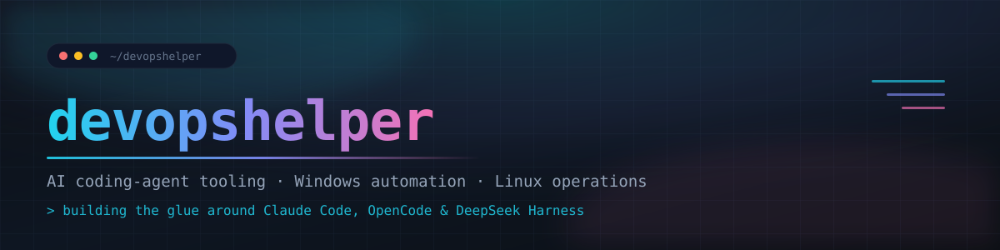

<div align="center">



<a href="https://github.com/devopshelper?tab=repositories">
  
</a>

<br/>


</div>

---

### What I actually do

I build the **plumbing around AI coding agents** — the statuslines, themes, installers and bridges that make a terminal agent feel like a real product. Alongside that: server control planes and mail infrastructure, because someone has to keep the boxes alive.

Most of my work starts as a personal annoyance at 1 a.m. and ends as a small, dependency-light tool that has to survive a reboot without supervision.

```yaml
focus:
  - agent harness tooling      # statuslines, themes, installers, session telemetry
  - windows + linux operations # supervisors, TUI control planes, autostart that actually fires
  - mail deliverability        # SPF/DKIM/DMARC, reputation, testing
  - persian / RTL interfaces   # dual calendars, right-to-left typography
```

---

### Featured work

<table>
  <tr>
    <td width="50%" valign="top">
      <h4>🐧 <a href="https://github.com/devopshelper/servctl-tui">servctl-tui</a></h4>
      <p>Terminal control plane for routine Linux administration across RHEL, Rocky, Alma, Ubuntu and Debian. Firewalld, systemd and the boring-but-critical day-two operations, without a browser.</p>
      <p><code>Python</code> · <code>Textual</code> · <code>★ 3</code></p>
    </td>
    <td width="50%" valign="top">
      <h4>📮 <a href="https://github.com/devopshelper/happydeliver">happydeliver</a></h4>
      <p>Self-hosted email deliverability testing platform. Throw mail at it, find out whether the internet will actually accept it — authentication, reputation and header reality checks.</p>
      <p><code>Go</code> · <code>★ 1</code></p>
    </td>
  </tr>
  <tr>
    <td width="50%" valign="top">
      <h4>📟 <a href="https://github.com/devopshelper/DSH-statusline">DSH-statusline</a></h4>
      <p>A living statusline for DeepSeek Harness — real session figures in the composer cells, breathing motion, click wave. Telemetry you want to look at.</p>
      <p><code>JavaScript</code> · <code>★ 1</code></p>
    </td>
    <td width="50%" valign="top">
      <h4>🎨 <a href="https://github.com/devopshelper/claude-style-deepseek">claude-style-deepseek</a></h4>
      <p>Claude Code's warm palette and transcript flow, ported to DeepSeek Harness: live thinking window, one-line tool calls, collapsible step summaries.</p>
      <p><code>JavaScript</code> · <code>★ 0</code></p>
    </td>
  </tr>
  <tr>
    <td width="50%" valign="top">
      <h4>🌐 <a href="https://github.com/devopshelper/dsh-arabic-vazirmatn">dsh-arabic-vazirmatn</a></h4>
      <p>One Windows script that installs Arabic RTL support into DeepSeek Harness and switches the UI to Vazirmatn. Right-to-left, done properly.</p>
      <p><code>PowerShell</code> · <code>★ 1</code></p>
    </td>
    <td width="50%" valign="top">
      <h4>📊 <a href="https://github.com/devopshelper/opencode-desktop-statusbar">opencode-desktop-statusbar</a></h4>
      <p>Live session telemetry in the OpenCode desktop app status bar — model, tokens, cost and activity, where your eyes already are.</p>
      <p><code>TypeScript</code> · <code>★ 0</code></p>
    </td>
  </tr>
</table>

---

<div align="center">


<br/>


<br/>


<br/><br/>

<h3>Currently</h3>

<table>
  <tr>
    <td align="left">
      🔭 <b>Building</b> — a Telegram control surface for the coding agents running on my own machines<br/>
      🌱 <b>Digging into</b> — agent session internals: transcripts, resume semantics, live telemetry<br/>
      🧰 <b>Maintaining</b> — nine small tools, each one replacing something I refused to keep doing by hand<br/>
      💬 <b>Ask me about</b> — Windows autostart that actually fires, supervisor loops, harness theming<br/>
      ⚡ <b>Rule I code by</b> — if it can't survive a reboot unattended, it isn't finished
    </td>
  </tr>
</table>

<br/>


<br/><br/>


<br/><br/>

<sub>Small tools, boring reliability, zero corporate theatre. · <code>git commit -m "still here"</code></sub>

</div>
